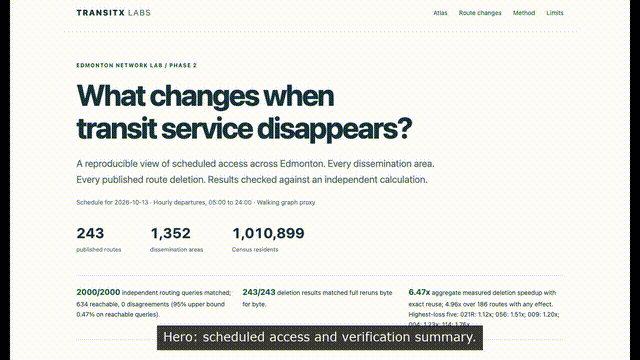
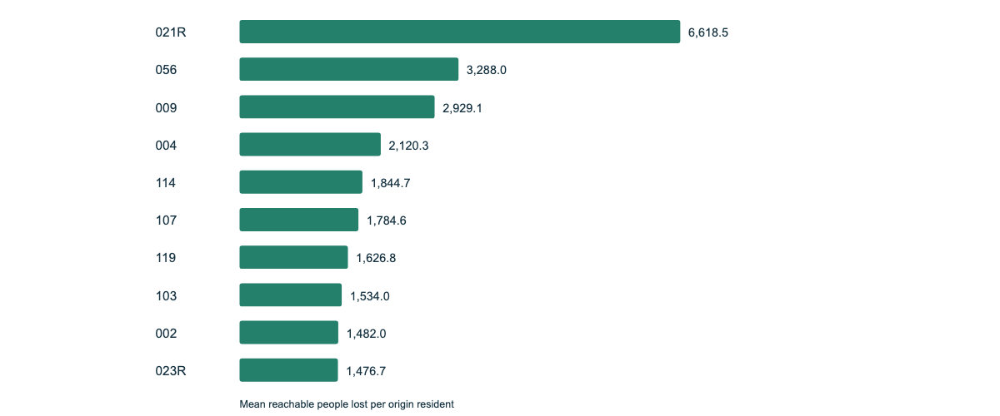
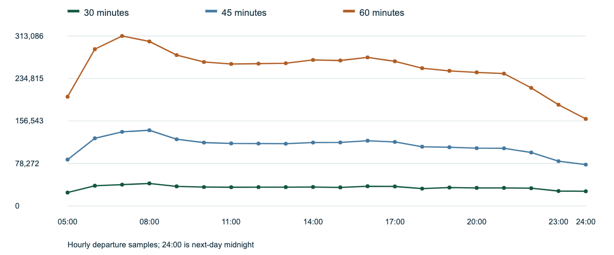
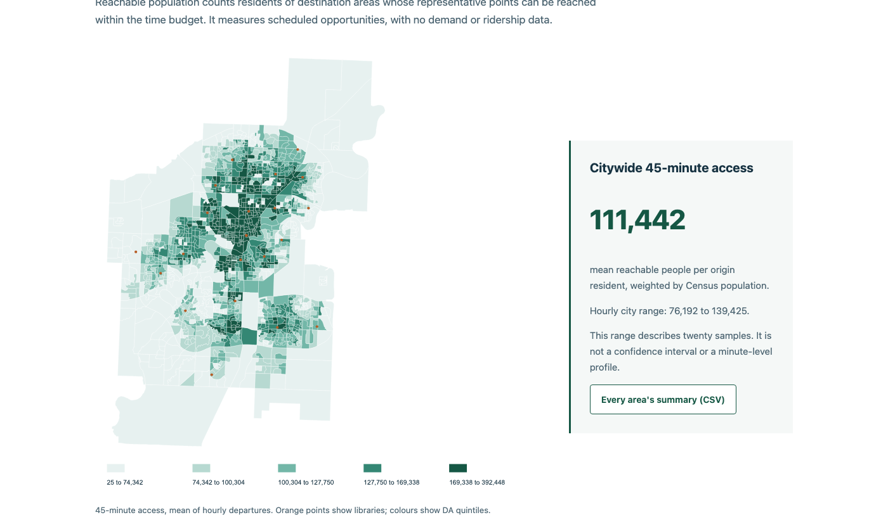
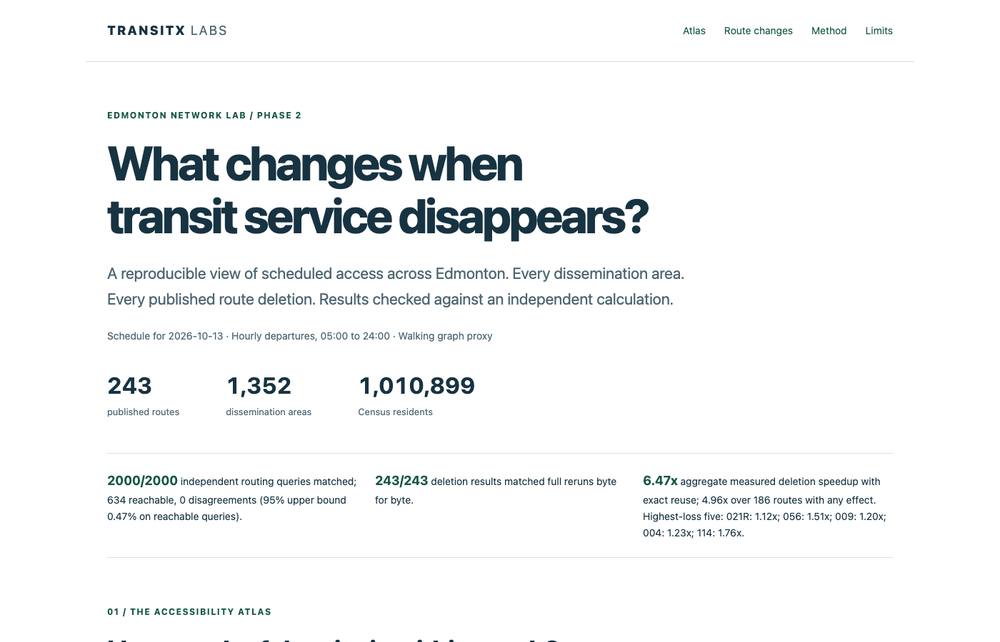
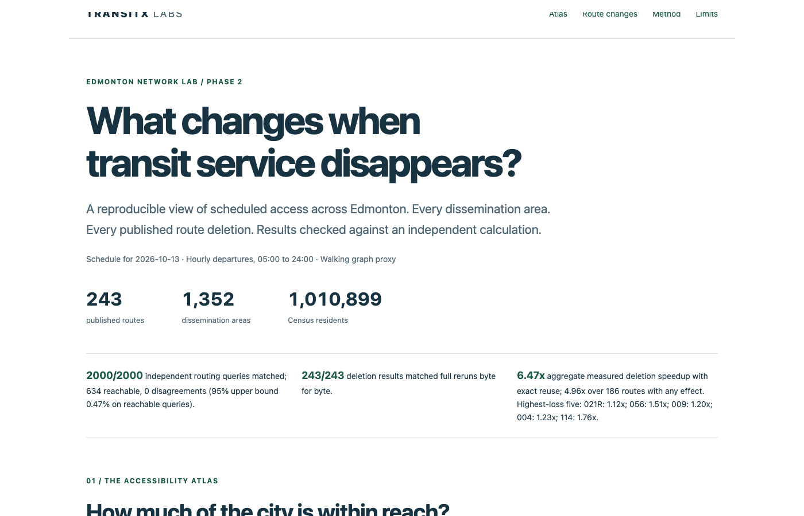
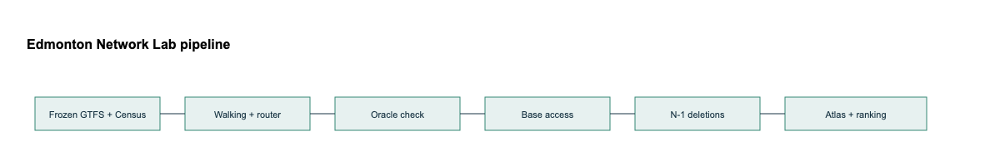

# Edmonton Network Lab

Edmonton Network Lab, a TransitX Labs Inc. research release, measures how many people and public libraries residents can reach by scheduled transit in 30, 45 and 60 minutes, and how that changes if one route is removed. It has no City endorsement. For transit planners, city staff and researchers who weigh what a route change would do to residents' access.


**Try it live:** [https://transitxlabs.github.io/edmonton-network-lab/](https://transitxlabs.github.io/edmonton-network-lab/) (static atlas; no install). See [docs/PAGES_TODO.md](docs/PAGES_TODO.md) for enabling GitHub Pages.

[](https://transitxlabs.github.io/edmonton-network-lab/media/demo.mp4)

Captions: [docs/media/demo.en.vtt](docs/media/demo.en.vtt) (burned into the recording frames). Poster: [docs/media/demo-poster.png](docs/media/demo-poster.png).

| Result charts | |
| --- | --- |
|  |  |

| Example outputs | |
| --- | --- |
|  |  |
|  | |

## How it works

1. Freeze Edmonton's published transit feed: 243 routes, 6,790 stops and 86,628 trips.
2. Use all 1,352 Census dissemination areas as origins and as population destinations, plus 22 public libraries as destinations.
3. Connect each area to the City road network for walking (road centrelines do not certify sidewalks).
4. Route departures every hour from 05:00 to 24:00 on service day 2026-10-13.
5. Count the people and libraries reachable in 30, 45 and 60 minutes.
6. Check the router against an independent connection scan (the oracle).
7. Remove each route in turn, with and without reusing results that the selected optimal journey proves unchanged.
8. Write the route ranking, the static atlas and the technical note.

Aggregate measured deletion speedup with reuse: 6.47x overall; 4.96x on 186 routes with any effect (for example route 021R: 1.12x).

## Architecture



- Compiled round-based router plus independent connection-scan oracle (`src/network_lab/`).
- Frozen inputs and manifests under `data/`; numerical results under `results/`.
- Static atlas and CSV exports under `docs/site/` (rendered by `scripts/render.py` during rebuild).

## Design choices

- **Hourly departure samples** keep the published timetable checkable within the report window; the full minute grid is not inferred between samples (`results/design.json`).
- **Exact deletion reuse** reroutes only batches where a surviving optimal journey certifies unchanged arrivals; full reruns confirm byte-identical outputs.
- **Road-centreline walking** links Census interior points to stops; it does not certify sidewalks, barriers or pathway times.
- **Population-weighted 45-minute loss** ranks route removals by scheduled access dependence, not passengers, funding priority or ridership.

## Why it matters

It shows which routes residents' access by the published timetable depends on most, with numbers that can be rebuilt.

Showcase images and the demo recording can be regenerated with:

```sh
python scripts/make_showcase_media.py
```

(Google Chrome headless and ffmpeg required.)

## Measured results

| Check | Result | Denominator |
| --- | --- | --- |
| Independent connection scan | 100% match | 2000 random queries; 634 reachable; 0 disagreements; reachable-query 95% upper bound 0.47% |
| Reuse versus full rerun | Byte-identical | 243 full checks; all 243 routes evaluated |
| Deletion runtime | 5,320.07 s full; 821.85 s reuse | Four workers, all routes, loaded model |
| Aggregate measured speedup | 6.47x; 4.96x on 186 routes with any effect | Ratio of summed wall times; highest-loss five: 021R: 1.12x; 056: 1.51x; 009: 1.20x; 004: 1.23x; 114: 1.76x |

| Budget | Mean reachable people per origin resident | Hourly range, people | Mean reachable libraries | Hourly range, libraries |
| --- | --- | --- | --- | --- |
| 30 minutes | 33,913.6 | 24,649.9 to 41,452.4 | 1.27 | 0.91 to 1.59 |
| 45 minutes | 111,442.3 | 76,192.2 to 139,424.6 | 3.81 | 2.82 to 4.70 |
| 60 minutes | 253,441.2 | 160,284.7 to 313,086.4 | 7.95 | 5.38 to 9.57 |

City means weight origins by Census population and average hourly departures.
Ranges describe these samples, not confidence intervals. Numbers are traced to
results/summary.json, oracle.json, reference_benchmark.json and deletion_timings.json.
The reference benchmark retains the latest complete run after the walking repair; benchmark.json records
the current execution, including fresh replay timings when applicable.

The [complete N-1 ranking](results/n1_ranking.csv) retains all published routes,
including inactive routes with measured zero effects. Its score is
origin-population-weighted 45-minute access lost, averaged across hourly samples.
It is scheduled dependence, not passengers, funding priority or ridership.

## City figures without moved-point origins

Sensitivity excludes the 12 moved-point origins (5,553 residents), leaving 1,340 origins (1,005,346 residents). Both calculations retain every destination and its population; each averages twenty departures and weights included origins by Census population.

| Budget | All origins: people / libraries | Without moved origins: people / libraries |
| --- | ---: | ---: |
| 30 minutes | 33,913.6 / 1.27 | 34,081.0 / 1.27 |
| 45 minutes | 111,442.3 / 3.81 | 111,985.6 / 3.83 |
| 60 minutes | 253,441.2 / 7.95 | 254,635.5 / 7.99 |


## Walking access changes and frozen exceptions

12 areas (5,553 residents) moved their access point. Original and moved coordinates, connector metres and added seconds are recorded in [walking_snaps.json](data/manifests/walking_snaps.json) and the model index. The frozen exception list contains 7 populated areas (2,780 residents). The 12 moved access points are 592 m to 4,329 m from their interior points, adding 446 s to 3,256 s (about 7 to 54 minutes) of walking. Every area remains in every denominator.

| Area ID | Population | Reason |
| --- | ---: | --- |
| 2021S051248112451 | 336 | only own populated area reachable by walking in 60 minutes |
| 2021S051248112459 | 319 | only own populated area reachable by walking in 60 minutes |
| 2021S051248112460 | 259 | only own populated area reachable by walking in 60 minutes |
| 2021S051248112470 | 122 | only own populated area reachable by walking in 60 minutes |
| 2021S051248112493 | 25 | only own populated area reachable by walking in 60 minutes |
| 2021S051248112568 | 1,521 | only own populated area reachable by walking in 60 minutes |
| 2021S051248112577 | 198 | only own populated area reachable by walking in 60 minutes |

The unchanged list, timestamp and SHA-256 are in [walking_exceptions.json](data/manifests/walking_exceptions.json) and [its registration](data/manifests/walking_exceptions_registration.json).

| Route | 45-minute loss | Hourly rank range | Departures in top ten |
| --- | ---: | --- | ---: |
| 021R | 6,618.5 | 1 to 6 | 20/20 |
| 056 | 3,288.0 | 1 to 8 | 20/20 |
| 009 | 2,929.1 | 1 to 8 | 20/20 |
| 004 | 2,120.3 | 2 to 13 | 19/20 |
| 114 | 1,844.7 | 3 to 28 | 14/20 |
| 107 | 1,784.6 | 3 to 22 | 16/20 |
| 119 | 1,626.8 | 3 to 18 | 9/20 |
| 103 | 1,534.0 | 4 to 22 | 10/20 |
| 002 | 1,482.0 | 4 to 43 | 11/20 |
| 023R | 1,476.7 | 5 to 20 | 11/20 |

Top ten under the 45-minute measure; hourly ties use route identifier.

30-minute top five: 021R (717.4); 119 (667.8); 009 (648.3); 107 (570.8); 005 (525.0).

60-minute top five: 021R (26,586.0); 056 (11,269.8); 009 (6,113.4); 004 (5,725.3); 023R (5,394.8).

The prospective 0.95 rank-materiality convention requires strong agreement; the scheduled 30-versus-45-minute reference is 0.944 over 182 routes with non-zero population loss at 30 or 45 minutes.

The frozen amendment's reference value 0.945433613392293 was computed over the 186 routes with a loss at any budget.

## Inspect and rebuild

Open [the static atlas](docs/site/index.html), the
[six-page technical note](docs/TECHNICAL_NOTE.pdf), its
[Markdown source](docs/TECHNICAL_NOTE.md) and the [proof](docs/REUSE_PROOF.md).
The page uses plain HTML/CSS and local SVGs, with no tracking or external resources.
Complete accessible CSVs accompany the charts.
Array dimensions, index maps, units and null-check meanings are in
[the output format guide](docs/OUTPUTS.md).

Requirements: Python 3.14, a C++17 compiler and requirements.lock. From a clean
checkout, run:

```sh
./rebuild.sh
```

The command installs locked packages if needed, verifies frozen hashes, prepares
inputs, recompiles routing, checks the oracle, evaluates every route deletion with
and without reuse, renders outputs and validates artifacts. Numerical rebuilding
uses no network; initial package installation may access the package registry.
Use NETWORK_LAB_PYTHON=/absolute/path/to/python for an existing locked runtime.
The option --replay recomputes every reused N-1 result and fully reruns twenty
seeded random deletions. Clean-checkout checksums and exits are in
results/replay_receipt.json. Timing receipts are new measurements and excluded
from numerical equality.

Run fixtures with python -m pytest -q. CI also runs lint, formatting, types and
frozen hash checks. Test network access is disabled; local checks do not imply
hosted CI execution.

For an offline what-if query at any service-day minute, use:

```sh
PYTHONPATH=src .venv/bin/python -m network_lab.query \
  --origin 2021S051248110083 --departure 08:00 --remove-route 023R
```

Repeat --remove-route to combine route deletions. The command reports each
travel-time budget and whether surviving selected journeys certified reuse.
Arbitrary trip deletions use the delete_service and certificate_survives APIs;
twenty alternating-trip frequency reductions are checked in
results/frequency_checks.json and frequency_queries.csv.

## Model and limits

The compiled engine scans trips in boarding rounds without a fixed transfer
limit, respecting pickup, drop-off, prohibited transfers and minimum transfer
times. The City road graph and station pathways supply walking access, transfers
and egress. Integer seconds and a sixty-minute horizon cover all reported budgets.
Later arrival times are not estimated.

Base records store one selected optimal journey per destination, with route and
trip occurrences. A surviving certificate proves exact arrival reuse. All tied
optimal journeys are not enumerated. Affected origin/departure batches are rerouted,
which can reroute unaffected destinations within the batch. Frequency reductions
may use the rule when represented as trip deletions; retiming or additions need
a new base run.

The decomposition is signed counterfactual accounting: walking, zero-wait
shifted-trip geometry, then timetable (scheduled minus walking minus geometry).
Components add to scheduled access. Headway and span are combined because the
extension rule creates artificial all-day service for short patterns. This
calculation uses no span extension and is not causal estimation.

Road centrelines do not certify sidewalks, crossings, barriers, entrances, grade
separation, mobility access or pathway duration. Each Census area uses one
interior point; every area remains in every denominator. Connectors target the
largest road component within 300 m. If that fails, use the nearest point of the
official area polygon when its connector is within 300 m. Original-to-access
straight distance adds walking time at 1.33 m/s on access and egress; original
coordinates remain in the outputs. The build requires the exact frozen exception
set and fails on any different set. Exceptions remain in every denominator with
access computed as is. Stops without a
walking connector serve only as on-board stops. At 1.33 m/s, walking may overstate
access for older people and in winter. Integer-ceiling edge times are conservative
(about half a second per edge); omitted trails, walkways and footbridges understate
reach. The City's segment-type field marks 820 ramp and collector-distributor segments (733 of them Arterial-Class B). They are retained as walkable, which may overstate reach near interchanges.
Roads without sidewalks may overstate reach. Straight connectors ignore barriers and may overstate
reach. Library opening
hours, fares, demand, capacity, on-demand service and realised delay are outside
the primary model. Exact deletion equality does not remove these limits.

## Data, prospective protocol and release

Dated note, 2026-10-11: during a build session from 10:58 to 11:34 PT, an unscoped search for files named AGENTS.md ran over the folder that contains the real-time collector; it printed no path inside the collector folder, and no collector file or payload was opened. Earlier, at about 02:10 PT, before the original registration at 02:12:15 PT, the phase 1 build read the collector's source code and listed its code files only; the collector's data and log folders are excluded from such listings by its ignore rules. At about 12:05 PT the CEO seat listed the collector folder's top level (code files and the names of the data and log folders, no data file names) while checking this note. All protocol decisions, including amendment 1 (06:35 PT), were registered before these listings, except the phase 1 code read, which preceded the original registration and saw no data.

[DATA.md](DATA.md) preserves licences, source URLs and required attribution.
Frozen inputs, table counts, rejection ledgers, calendars and walking assumptions
are under data/. Code is Apache-2.0; data retain their source licences.

[PROTOCOL_REALTIME.md](PROTOCOL_REALTIME.md) pre-registers a future observed-service
comparison. Its commit, hash and time are in data/manifests/protocol_registration.json.
[PROTOCOL_AMENDMENT_1.md](PROTOCOL_AMENDMENT_1.md) freezes the decision outcomes,
coverage handling, primary latest-arrival bound and twenty-eligible-weekday
collection rule (45-day cap); its time and hash are in
data/manifests/protocol_amendment_1.json. The collector is read only.
The pilot inventory describes files and fetch logs,
with no decoded payloads or reliability claim. No publication, push or remote
repository creation is performed.

Contains information licensed under the Open Government Licence – City of Edmonton.

Adapted from Statistics Canada, 2021 Census of Population, 2021. This does not
constitute an endorsement by Statistics Canada of this product.
